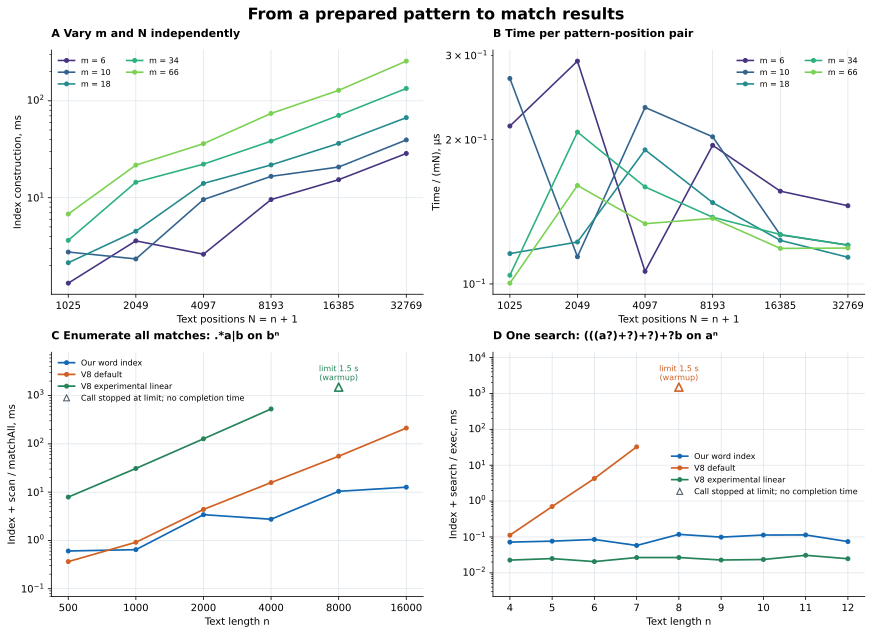

# JSRegex: match every start in O(mN) time

This artifact implements JavaScript-style matching with captures, greedy and lazy repetition,
lookahead, lookbehind, and atomic groups. Here **m is the original pattern-tree size** and
**N is the number of text positions, including the end**. The main JavaScript implementation
builds a queryable index in O(mN) time and words; each query returns its endpoint in O(1)
and its k defined capture spans in O(1+k).

## Generate the comparison graphs

**Run this to see how our implementation and V8 behave, with the raw data and checks included.**
Use Python 3.11+ and Node.js 24+ (`NODE` can select another Node executable).

```sh
git clone https://github.com/yuezato/jsregexengine.git
cd jsregexengine
python3 -m venv .venv
. .venv/bin/activate
python3 -m pip install -r review/requirements.txt
python3 reproduce.py demo
```

Open **`results/reviewer-demo/index.html`** in a browser. The command generates the report,
standalone SVG/PNG graphs, CSV tables and `data.json` containing every sample, runtime version,
flag and source fingerprint. After installing matplotlib, it needs no network connection.
The default is a short grid; a single prepared matching call is capped at 1.5 seconds.

| Experiment | What is timed | What to look for |
|---|---|---|
| Vary m and N independently | Our all-start index for nested nullable lazy `+?`, with captures | Growth with mN and the time divided by mN |
| Enumerate all matches of `.*a\|b` on n copies of `b` | Our index + scan; V8 `matchAll` | Sharing between starts versus repeated scans of the remaining suffix |
| Search for `(((a?)+?)+?)+?b` on n copies of `a` | Our index + search; one V8 `exec` | Default backtracking versus the index and V8's experimental linear engine |

The first pattern starts at `a?` and wraps it in `(…)+?` d times: m = 2+2d.
The other experiments compare the same observable result on each engine, including failure.
The report also probes which depths V8's experimental `l` flag accepts.



Example run (`--profile full`): Node.js 24.22.1 / V8 13.6.233.17-node.58. The [saved raw data](docs/reviewer-example/data.json)
identify the machine and exact sources. Timings vary by host. Triangles denote interrupted calls,
not completed times; rejected and unmeasured cases are recorded separately.
The experimental V8 engine handles the shallow search example, but linearity of one search
does not imply linear time for repeated global searches. These families isolate particular
worst-case behaviors; they are not a typical-workload throughput ranking.

**Parsing is outside the timer.** Pattern preparation and input construction also precede the
comparison timer; our timed work includes all text-dependent index construction. Each completed
sample is checked after timing. See [exact tasks and timing boundaries](REPRODUCING.md#timing).

For a larger grid or a different per-call limit:

```sh
python3 reproduce.py demo --profile full --timeout-ms 5000
```

## Check why the implementation is product-linear

Graphs illustrate the behavior. The bound comes from the algorithm's bounded loops and the
paper's proofs. The demo also counts **executed operations**, separately from timing:

- Exactly mN selections, at most 2mN worklist pops and at most 4mN predecessor inspections.
- Seven families covering repetitions, failure, both lookaround directions, commitment and sparse captures.
- All endpoints and ordered capture spans checked; a query with k defined captures visits at
  most max(0, 2k−1) output records.

Run the checks without plotting dependencies:

```sh
python3 reproduce.py quick    # work counts, algorithm examples and overlapping-start control
python3 reproduce.py full     # also the full semantic and differential suites
```

The commands stop on any mismatch and end with `PASS: quick` or `PASS: full`.
The full run checks 521,904 standard JS rows, 18,864 atomic rows, 23,238 functional batch rows,
9,207 Python packed rows and 146,599 forest/stop-set pairs, plus the public Python tests.
For the code-to-proof map, exact checks and cost model, read [REPRODUCING.md](REPRODUCING.md).

## Read or use the algorithm

The **complete word index is 296 nonblank, noncomment lines in three JavaScript modules**
(323 physical lines), including tree preparation. It has no external dependencies.
`python3 review/size.py` counts its full module dependency set.

| File | Read it for |
|---|---|
| [pattern.mjs](paper/index/pattern.mjs) | Prepare the occurrence tree, number captures and build region graphs |
| [layers.mjs](paper/index/layers.mjs) | Mark viable exits one position layer at a time |
| [word_index.mjs](paper/index/word_index.mjs) | Select full/moving results, retain the last iteration and report captures |

For example, `(?=(a+))a` tests and captures an `a` suffix without consuming it, then consumes
one `a`. Save this as `example.mjs` in the repository root and run `node example.mjs`:

```js
import {compile, prepareMatches} from './paper/index/word_index.mjs';
const t = (kind, ...parts) => ({kind, parts});
const a = t('character', 'a');
const pattern = t('sequence',
  t('assertion', t('capture', t('repeat', a, '+', false)), 1, false), a);
const program = compile(pattern);           // depends only on the pattern
const index = prepareMatches(program, 'aaa'); // all text-dependent preprocessing
console.log(index.endpoint(1));             // 2
const captures = [];
index.report(1, (slot, lo, hi) => captures.push([slot, lo, hi]));
console.log(captures);                      // [[0, 1, 3]]
```

`report` emits only defined captures, in opening-parenthesis order, using zero-based slots and
half-open spans. Failure returns `null`. An optional allowed-exit vector restricts the selected
endpoint. The [detailed API and checks](paper/README.md) also describe dense output.

## The separate space-efficient implementation

| Interface | Purpose | Guarantee in the paper |
|---|---|---|
| JS `prepareMatches`, then `endpoint` / `report` | Query any start after indexing | O(mN) time and words; O(1+k) sparse query (Theorem 1.2) |
| Python `Regex.all_starts` in [bitre.py](bitre.py), with [bitcolumns.py](bitcolumns.py) | Write all dense answers once | O(mN) time and O(mN) workspace bits in the stated RAM model, excluding delivered output (Theorem 8.1) |

The new graph demo times the JavaScript word index. The Python implementation provides the
additional space guarantee; interpreter RSS is not the theorem's bit-space measure.
Python `index(text).match_at(x)` replays one chosen match and is not the JS sparse-query index.
See the [Python API and examples](docs/PYTHON.md) and [archived Python experiments](docs/HISTORICAL.md).

The matching core takes a prepared occurrence tree with constant-cost primitive tests. It
excludes backreferences and succinct general counted repetition. It is not an ECMAScript source
parser. The Python front end accepts a documented subset of concrete syntax and uses code-point
offsets; its parsing time is outside the matching guarantee. Atomic groups and possessive
quantifiers are supported extensions, not required of the native V8 comparison.
